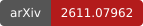

# TCSExam

[](https://moonshotai.github.io/TCSExam/)
[](https://arxiv.org/abs/2611.07962)
[](https://moonshotai.github.io/TCSExam/docs/zh/)
[](licenses/README.zh-CN.md)

语言：[English](../README.md) | [简体中文](README.zh-CN.md)

TCSExam 用可验证的理论计算机科学研究任务评测模型与 agent 组成的系统。
本仓库面向查看题目、运行评测和比较已核验结果的研究者。

从[文档首页](index.zh-CN.md)选择阅读路径。首次运行评测，请阅读
[从零运行 TCSExam](getting-started.zh-CN.md)；已有运行环境时，查阅
[运行配置与参数](running.zh-CN.md)。

<a id="tasks"></a>

## 题目

Full 包含 100 道题；Lite 从 Full 的各类题目中各选取 5 道，共 20 道。
读法说明：表格列出各套件的题目数量；每道 Solver 题分别提供 Online 和 Offline 两个题目包。

| 评测套件 | 定理证明 | 求解器工程 | 构造 | 开放猜想 | 合计 |
|---|---:|---:|---:|---:|---:|
| Full | 20 | 30 | 20 | 30 | **100** |
| Lite | 5 | 5 | 5 | 5 | **20** |

定理证明题要求用 Lean 证明已发表的结果。Solver 题要求实现算法，并在隐藏实例上
评测。构造题要求给出可验证的构造或界。开放猜想题接受对所述猜想的完整 Lean
证明或证伪。每道题的陈述和来源见[题目目录](tasks.zh-CN.md)。

Full 默认使用 Online Solver，在模型开发期间提供判分反馈。Lite 默认使用
Offline Solver，在开发期间提供公开自测，并在之后进行隐藏判分。两套评测均可
通过 `--solver-protocol` 选择任一协议；请分别报告各协议的结果。
[Solver 协议](solver-protocols.zh-CN.md)定义了反馈与网络规则。

<a id="run-an-evaluation"></a>

## 运行评测

需要 Linux x86-64 主机、Python 3.12+、带 Compose 和 Buildx 的 Docker Engine，
以及模型 API 账户。运行依赖会安装 Harbor 0.22.0，用于运行 agent 并收集其输出。
Solver 判分还需要 Landlock ABI 3 或以上版本，以及必要的容器系统调用权限。
Online Solver 使用判分后端；Offline Solver 的控制器在 Docker 主机上运行。
主机资源配置见[运行环境要求](runtime-availability.zh-CN.md)。

[入门指南](getting-started.zh-CN.md)依次介绍克隆、安装、运行单道
`discrete-bidding-games` 题目、运行 Lite 和 Full，以及读取实际结果文件。
指南默认使用 Kimi Code，也支持 Claude Code、Codex 和 Grok Build；
[agent 配置](running.zh-CN.md#choose-an-agent)提供相应设置和命令。

题目选择、预算、凭据和已保存任务配置见[运行配置与参数](running.zh-CN.md)；输入与镜像
构建见[资源准备](resources.zh-CN.md)；Online Solver 服务部署见
[Docker 后端指南](backend/docker.zh-CN.md)。源码包的内容与构建入口见
[源码包](source-delivery.zh-CN.md)。

<a id="scores"></a>

## 分数

```text
TCSExam Index = 30 × theorem success
             + 30 × fixed-K3-relative Solver score
             + 30 × original Construction score
             + 10 × complete Open-conjecture success
```

先在每道题内对采纳的尝试取平均，再在每条题型内对题目等权取平均。
报告 Index 时同时给出四条题型的分数。构造题分数可以超过一，因此 Index
以点为单位，可能超过 100。判分失败或缺失应与已完成判分的零分区分记录。
[评分](scoring.zh-CN.md)定义了公式、固定 Solver 参考成绩，以及
`tcsexam solver-score` 和 `tcsexam score` 的输入格式。

<a id="license-and-citation"></a>

<a id="许可与引用"></a>

## 许可与第三方材料署名

项目自行编写的代码、检查器、脚本和构建配置使用 [Apache-2.0](../LICENSE)。
原创题面、文档和网站内容使用 [CC BY 4.0](licenses/CC-BY-4.0.txt)。
[论文 PDF](../paper.pdf) 单独采用 [CC BY-NC-ND 4.0](https://creativecommons.org/licenses/by-nc-nd/4.0/)。
第三方材料保留其各自条款；请保留题目中的来源和
[声明](licenses/THIRD_PARTY_NOTICES.zh-CN.md)。再次分发输入或镜像前，请查阅
[许可指南](licenses/README.zh-CN.md)。

如有署名、许可或材料使用方面的问题，请在仓库中提交 Issue；
[更正流程](licenses/README.zh-CN.md#rights-and-corrections)介绍了处理办法。
开发和源码导出说明见 [CONTRIBUTING.md](../.github/CONTRIBUTING.zh-CN.md)。

<a id="引用"></a>

## 引用 TCSExam

在研究中使用 TCSExam 时，请引用[论文](https://arxiv.org/abs/2611.07962)。[导出 BibTeX](https://arxiv.org/bibtex/2611.07962) · [下载 PDF](../paper.pdf)。

```bibtex
@misc{luo2026tcsexamevaluatingfrontierllms,
  title={TCSExam: Evaluating Frontier LLMs on the Full Range of TCS Research},
  author={Yifan Luo and Zhengying Liu and Yang Yuan and Zhilin Yang and Andrew Chi-Chih Yao},
  year={2026},
  eprint={2611.07962},
  archivePrefix={arXiv},
  primaryClass={cs.AI},
  url={https://arxiv.org/abs/2611.07962},
}
```
